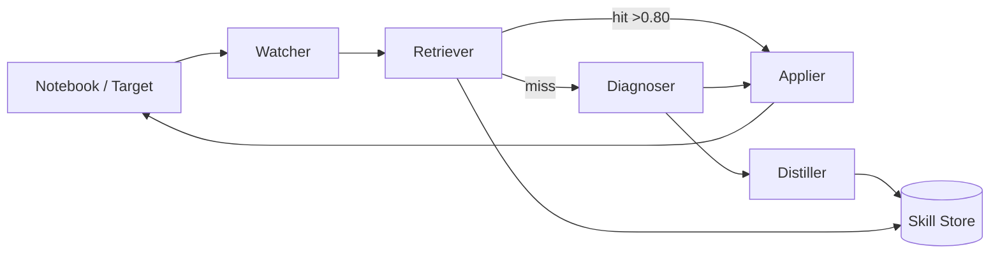
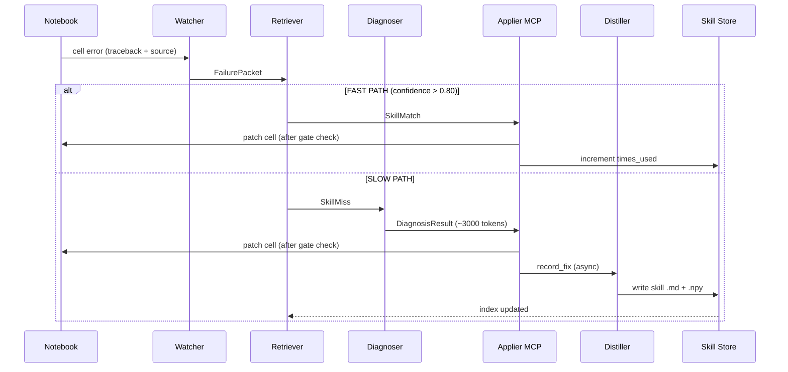

# SkillForge — Architecture Document

> **One-line:** An autonomous agent that fixes notebook errors AND distills each fix into a reusable Claude Skill, giving AI agents the procedural memory they're missing today.

---

## System Overview

SkillForge fills the gap between conversation memory (ephemeral) and factual memory (static) with **procedural memory** — structured "if you see X, do Y" patterns built from real fixes. When a notebook cell errors, four agents collaborate in an A2A pattern: a **Watcher** captures the failure context, a **Retriever** checks whether we have already solved this class of error, a **Diagnoser** generates a fix if we haven't, and a **Distiller** encodes the solution as a reusable skill file. Every fix after the first is resolved from the skill library at roughly 1/50th the token cost of the original.

The fix surface is Jupyter notebooks for V1 because they make failure and recovery visceral: a red cell turns green, a skill file appears in `skills/`, and a terminal dashboard ticks the tokens-saved counter upward. The engine is target-agnostic — see [Extensibility](#extensibility) for how to attach new Watchers.



---

## Component Breakdown

### 1. Watcher

The Watcher is a file-system observer layered with an `nbclient` execution hook. It monitors a directory (or a specific notebook path) for kernel events. When a cell raises an exception, the hook captures three things and assembles a **FailurePacket**: the raw traceback (`stderr`), the source of the failing cell, and the source of the two cells that executed immediately before it (execution-order context, not file-order). The two-cell window is intentional — it catches variable definitions, imports, and data-loading steps that are causal precursors to the error without flooding the downstream prompt with the entire notebook.

**Output contract:** `FailurePacket { cell_id, traceback: str, cell_source: str, prior_cells: list[str], notebook_path: str, timestamp: ISO8601 }`

The Watcher is stateless; it emits packets and delegates all decision logic downstream. Multiple Watchers can run concurrently against different targets — see [Extensibility](#extensibility) for the interface contract a new Watcher must satisfy.

### 2. Retriever

The Retriever is the routing brain of SkillForge. It receives a `FailurePacket`, generates a short **error signature** (exception type + first meaningful frame of the traceback + a 3-gram from the error message), embeds it via `sentence-transformers` (all-MiniLM-L6-v2, running locally — zero API cost), and cosine-compares against embeddings cached alongside every skill file in `skills/`.

If the best match exceeds `confidence > 0.80`, the Retriever emits a **SkillMatch** and routes to the FAST PATH (Applier MCP). If no match exceeds the threshold, it emits a **SkillMiss** and routes to the SLOW PATH (Diagnoser). The 0.80 threshold is configurable per project via `.skillforge/config.yaml`; see [Trust & Safety](#trust--safety) for how the confidence band maps to approval gates.

**Input:** `FailurePacket`
**Output (FAST):** `SkillMatch { skill_id, skill_path, confidence, template_vars: dict }`
**Output (SLOW):** `SkillMiss { error_signature, embedding: np.ndarray }`

### 3. Diagnoser

The Diagnoser is the expensive reasoning step, invoked only on SLOW PATH. It constructs a structured prompt from the `FailurePacket` — traceback, failing cell, prior cells, and a concise task description of the notebook inferred from the first Markdown cell — and submits it to the configured LLM provider chain.

**Provider chain (V1):** Minimax primary (user's paid key, high rate limit) → Gemini free-tier fallback → Claude (gold-standard, rate-limited fallback). The chain is tried in order; first successful structured response wins. Responses are validated against a Pydantic schema before use.

**Output contract:** `DiagnosisResult { diagnosis: str, fix_code: str, explanation: str, confidence: float, provider: str, tokens_used: int }`

The Diagnoser does not apply fixes — it only returns structured data. Application is the Applier's responsibility so that sandboxing and approval gates are centralized in one place.

### 4. Distiller

The Distiller runs asynchronously after a fix has been **verified** (the formerly-failing cell re-executes without error). It receives the `DiagnosisResult` plus the original `FailurePacket` and makes a second, smaller LLM call (~400 tokens) whose only job is to produce a YAML+Markdown skill spec in the canonical schema (see [Data Model](#data-model)).

The Distiller also generates and persists the embedding for the new skill so the Retriever can use it immediately on the next matching failure. If the Distiller's output fails schema validation, the fix is logged but no skill file is written — the system degrades gracefully (SLOW PATH next time) rather than poisoning the skill store.

**Output:** writes `skills/{slugified-name}.md` + `skills/{slugified-name}.npy` (embedding array).

### 5. Applier MCP Server

The Applier is implemented as an MCP server using Anthropic's official Python MCP SDK (scaffold pattern from `modelcontextprotocol/servers`). It exposes three tools to any compliant MCP client (Claude Code, Cursor, custom scripts):

- **`apply_skill(skill_id, cell_source, notebook_path, dry_run=False)`** — instantiates a skill template with concrete variable values, optionally runs a dry-run diff, then patches the notebook cell via `nbformat`.
- **`list_skills(query?: str)`** — returns skill metadata (name, description, confidence, times_used) optionally filtered by a keyword query.
- **`record_fix(failure_packet, diagnosis_result, verified: bool)`** — called by the Diagnoser after fix verification; triggers the Distiller pipeline.

The MCP server is the **single enforcement point** for approval gates and risk classification. No fix code ever reaches a notebook cell without passing through the Applier.

### 6. Skill Store

The Skill Store is a `skills/` folder of `.md` files with YAML frontmatter. No database. This is a deliberate V1 simplicity decision: the files are human-readable, Git-diffable, and trivially portable — drop them into `.claude/skills/` of any Claude Code project and Claude itself can read and use them. Each skill has a paired `.npy` file holding its sentence-transformer embedding for fast cosine retrieval.

The store is append-only during normal operation. Skills are updated (confidence score, `times_used` counter) by the Applier after each successful application. Deletion requires manual intervention — there is no automated skill expiry in V1 (see ROADMAP.md for the V1.5 skill hygiene milestone).

---

## Data Model

The unit of agent capability in SkillForge is the **skill file**. Every skill is a single `.md` file with a YAML frontmatter block followed by three Markdown sections.

### Canonical Schema

```yaml
---
name: pandas-dtype-mismatch
description: Fix arithmetic on pandas object-dtype columns that should be numeric
triggers:
  patterns:
    - "TypeError: unsupported operand type(s) for"
    - "could not convert string to float"
    - "can only concatenate str"
  contexts: [pandas, dataframe, dtype]
confidence: 0.91
times_used: 7
created_at: 2026-05-09
---

# Diagnosis
A pandas column carries `object` dtype (often after CSV load with mixed/formatted values) but is being used in arithmetic that requires a numeric dtype.

# Fix template
```python
df['{COLUMN}'] = pd.to_numeric(df['{COLUMN}'], errors='coerce')
df = df.dropna(subset=['{COLUMN}'])
```

# Verification
Re-run the failing cell; check `df['{COLUMN}'].dtype` returns `float64` or `int64`.
```

### Field Commentary

| Field | Type | Purpose |
|---|---|---|
| `name` | slug string | Stable identifier used in file path and MCP references. Kebab-case, no spaces. |
| `description` | string | Human-readable summary; shown in `list_skills` output and Claude's tool context. |
| `triggers.patterns` | list[str] | Substring patterns matched against raw traceback text. Used by Retriever as pre-filter before embedding cosine match — fast rejection before embedding lookup. |
| `triggers.contexts` | list[str] | Loose semantic tags (framework, domain, resource type). Future: used by graph edges in V2. |
| `confidence` | float 0-1 | Retriever's match confidence at last successful application. Updated on each use. Drives approval gate routing (see Trust & Safety). |
| `times_used` | int | Running count of successful applications. Feeds the token-saved dashboard counter and surfaces high-value skills in `list_skills` ranking. |
| `created_at` | ISO date | Provenance. Used by the V1.5 skill hygiene job (see ROADMAP.md) to flag stale skills for review. |
| `# Diagnosis` | Markdown | Natural-language root cause. Shown to the user in the approval gate UI when confidence is in the 0.80-0.95 band. |
| `# Fix template` | fenced code | Parameterized fix code. Template variables use ALL_CAPS convention (e.g., `BATCH_SIZE`). The Applier resolves these against the live notebook namespace before patching. |
| `# Verification` | Markdown | Instructions for confirming the fix worked. Shown to user; optionally executed as a shell command if prefixed with `$`. |

### Why not a database?

The folder-of-files approach makes skills **first-class artifacts**: reviewable in PRs, shareable via Git, readable by Claude directly when placed in `.claude/skills/`. A database would make skills opaque to the tools the team already uses. V2 layers a graph index on top of the same files rather than replacing them — see [V2 Architecture Evolution](#v2-architecture-evolution).

---

## Control Flow: FAST PATH vs SLOW PATH

The two paths share entry (Watcher) and exit (Applier) but differ radically in cost and latency.

### FAST PATH (~80 tokens, ~200ms)

Triggered when Retriever finds a skill with `confidence > 0.80`.

1. Watcher emits `FailurePacket`.
2. Retriever embeds error signature (local, free), cosine-matches skill store.
3. `confidence > 0.80` → Retriever emits `SkillMatch`.
4. Applier receives `SkillMatch`, checks risk class of fix template (see Trust & Safety).
5. If `confidence > 0.95` AND risk class is LOW → auto-apply (no user prompt).
6. If `0.80 < confidence ≤ 0.95` OR risk class is MEDIUM → HumanLayer-style approval gate (terminal prompt, timeout 30s, default = apply).
7. User approves (or timeout) → Applier patches notebook cell.
8. Notebook re-executes cell; Applier increments `times_used`, updates `confidence` field.
9. No Diagnoser call. No Distiller call.

### SLOW PATH (~3000 tokens, ~8 seconds)

Triggered when no skill matches above threshold.

1. Watcher emits `FailurePacket`.
2. Retriever emits `SkillMiss`.
3. Diagnoser constructs prompt, calls LLM provider chain (Minimax → Gemini → Claude).
4. Diagnoser returns `DiagnosisResult`.
5. Applier applies confidence gates (same logic as FAST PATH but using `DiagnosisResult.confidence`).
6. Fix applied → notebook re-executes.
7. If re-execution succeeds → `record_fix` called → Distiller runs asynchronously.
8. Distiller writes new skill file + embedding to `skills/`.
9. Retriever's in-memory index updated (or reloaded on next startup).

### Sequence Diagram



---

## Trust & Safety

Safe code execution is non-negotiable. SkillForge applies fixes to live notebooks; a malformed or malicious skill file could corrupt data, exfiltrate secrets, or delete files.

### Confidence Gates (HumanLayer pattern)

SkillForge borrows the confidence-gated approval pattern from `humanlayer/humanlayer`:

| Confidence band | Default action |
|---|---|
| `≥ 0.95` + risk LOW | Auto-apply. No user prompt. Logged to `~/.skillforge/audit.log`. |
| `0.80 – 0.95` OR risk MEDIUM | Terminal approval gate. Shows diagnosis + fix diff. 30s timeout defaults to APPLY. User can reject or edit. |
| `< 0.80` OR risk HIGH | Blocked. Presented as suggestion only. User must manually copy fix code. |

The gate thresholds are configurable in `.skillforge/config.yaml`. Projects processing sensitive data (PII, financial) should raise the auto-apply floor to `0.98`.

### Risk Classification

Every fix template is classified at write time (by the Distiller) and re-evaluated at apply time (by the Applier). Classification is rule-based in V1:

- **HIGH risk:** fix contains `os.remove`, `shutil.rmtree`, `subprocess`, any network call (`requests`, `httpx`, `socket`), `eval`, `exec`, file writes outside the notebook's own directory, or environment variable mutation (`os.environ`).
- **MEDIUM risk:** fix modifies mutable global state, patches a class or function (`monkeypatch`), or writes to disk within the notebook directory.
- **LOW risk:** fix is purely additive in-cell code (imports, variable rebinding, arithmetic, library API calls with no side effects).

HIGH-risk fixes are **never auto-applied**, regardless of confidence. They are surfaced as suggestions with the diagnosis shown and an explicit warning. See ROADMAP.md for the V1.5 milestone on sandboxed fix preview (running fix in a throw-away kernel before applying to the live notebook).

### Fix Sandboxing

In V1, the Applier does a **dry-run diff** (shows the before/after cell source) before any patch is written, even on auto-apply. The actual patch uses `nbformat` to write a new notebook file to a temp path first; only on success is the original overwritten. This gives one level of atomicity — a partial write never corrupts the notebook on disk.

In V2, MEDIUM and HIGH risk fixes will be executed in an ephemeral kernel (spawned by `nbclient`, killed after the cell runs) with network and filesystem access restricted via `seccomp`/container isolation. See ROADMAP.md for the sandboxed preview milestone.

### Skill Poisoning Prevention

The Distiller validates every generated skill file against the canonical Pydantic schema before writing. A schema-invalid skill is logged and discarded. The Applier re-validates at apply time (defense in depth). Manual edits to skill files that break schema are caught at Applier startup (index build phase) and the broken skill is excluded with a warning.

---

## Cost Model

### Per-fix token accounting

| Path | Tokens (approx) | Latency | Cost (GPT-4 class) |
|---|---|---|---|
| SLOW PATH (first fix) | ~3,000 | ~8s | ~$0.009 |
| FAST PATH (skill hit) | ~80 | ~200ms | ~$0.00024 |
| **Ratio** | **37.5x** | **40x** | **37.5x cheaper** |

The ~80 tokens on FAST PATH are: the system prompt for the Applier tool call + the skill description + the variable binding prompt. Embedding generation is local (sentence-transformers) and costs zero API tokens.

### Break-even analysis

A new skill file pays for itself after **1 re-use**. The Distiller costs an additional ~400 tokens on the initial SLOW PATH fix (~$0.0012 extra). That overhead is recovered on the very first FAST PATH application (saving ~2,920 tokens vs a repeated SLOW PATH call).

For a team of 5 data scientists hitting the same class of pandas dtype error 3 times per week:

```
Without SkillForge:  3 × 52 × $0.009 = $1.40/year per error class
With SkillForge:     $0.009 (first) + 155 × $0.00024 = $0.046/year
Savings per class:   ~97% cost reduction
```

At scale — a data platform with 50 notebook users and 20 recurring error classes — the annual LLM spend on notebook debugging drops from roughly **$1,400 to under $50**. That is before counting human time saved.

### The LinkedIn narrative

Companies are cutting engineering headcount while paying for AI agents that re-solve the same bugs every day. Every repeated SLOW PATH call is money burned on retrieved context that was already discovered, explained, and could have been stored. SkillForge makes the cost curve go down as the system ages — the opposite of most LLM tooling, where costs scale linearly with usage. The skill library is a **depreciating cost asset**: you pay once, amortize forever.

The dashboard counter (tokens spent vs tokens saved, cache hit %, library size) makes this narrative visible in real time during the demo.

---

## Extensibility

SkillForge's Watcher is an interface, not a monolith. Adding a new failure target (CI logs, pytest output, service crash reports) requires implementing a single protocol.

### Watcher Interface Contract

Any new Watcher must:

1. **Emit a valid `FailurePacket`** with the fields listed in [Component Breakdown](#component-breakdown). The `cell_source` field maps to "the unit of code that failed" (a test function body, a CI step's shell command, etc.). `prior_cells` maps to "the two preceding units of context."

2. **Honor the `notebook_path` abstraction** — for non-notebook targets, this is the path to the source file or log file being watched. The Applier uses it to scope risk classification (writes to the same directory as the source file are MEDIUM risk, not HIGH).

3. **Implement a `patch(cell_id, new_source)` callback** that the Applier calls after fix approval. For notebooks, this is an `nbformat` write. For CI configs, this might be a YAML patch. For test files, a file edit via `ast.unparse`. The Watcher registers this callback with the Applier at startup.

4. **Implement a `verify(cell_id) -> bool` callback** that the Applier calls after patching to confirm the fix worked. For notebooks: re-execute the cell and check for no exception. For CI: re-run the step. For tests: run `pytest` on the affected test function. Verification is required before the Distiller is triggered.

### Example: Pytest Watcher

A `PytestWatcher` would:
- Hook `pytest`'s `pytest_runtest_logreport` to capture `report.longreprtext` (traceback) + `report.nodeid` (test identity).
- Derive `cell_source` from the test function source (via `inspect.getsource`).
- Derive `prior_cells` from the two fixtures the test uses (resolved via `pytest`'s fixture introspection).
- `patch` = overwrite the test function body via `libcst` or `ast`.
- `verify` = re-run `pytest -x {nodeid}` and check exit code.

The rest of the system (Retriever, Diagnoser, Distiller, Applier MCP) is unchanged. The skill files generated by fixing pytest failures are immediately usable in the notebook context too, if the error class is shared (e.g., a pandas `KeyError` is a pandas `KeyError` regardless of whether it surfaced in a test or a notebook cell).

See ROADMAP.md for the V1.5 milestone on the CI log Watcher (GitHub Actions integration).

### Adding a new LLM provider to the Diagnoser

The Diagnoser's provider chain is a list of callables conforming to `Provider(prompt: str) -> DiagnosisResult`. Adding a new provider requires:
1. Implementing the callable (handles SDK init, structured output parsing, error wrapping).
2. Appending it to the `providers` list in `.skillforge/config.yaml`.

No other code changes. The chain tries providers in order and uses the first successful structured response.

---

## V2 Architecture Evolution

V2 keeps all V1 components but replaces three subsystems and adds one new protocol.

### Graph-based Skill Memory

**What changes:** The flat `skills/` folder + numpy embeddings are augmented (not replaced) with a **PageIndex** (from `VectifyAI/PageIndex`) for indexed retrieval and a **graphify** layer (from `safishamsi/graphify`) that maintains typed edges between skills.

**Why:** Embedding cosine similarity finds "close" skills but cannot express structured relationships: "skill A is a special case of skill B", "skill C supersedes skill D for PyTorch 2.x", "skills E and F are commonly applied together". Graph edges encode these relationships explicitly, enabling the Retriever to walk the graph and propose compound fixes (apply skill E then skill F) rather than single-skill matches.

**What stays the same:** Skill files themselves are unchanged (YAML+Markdown). The graph is a derived artifact built from the files, not a replacement for them. Portability is preserved.

**Retriever change:** In V2, the Retriever first does a PageIndex lookup (faster indexed retrieval than brute-force cosine), then walks graph edges to find related skills, then ranks candidates by confidence × recency × graph-degree. The output is a ranked list of `SkillMatch` candidates rather than a single match.

### llm-council Fix Validation

**What changes:** The Diagnoser's single LLM call is replaced with a **council pattern** (from `karpathy/llm-council`): Sonnet proposes a fix, Haiku reviews it for correctness and risk, Gemini tiebreaks if they disagree.

**Why:** Single-LLM fixes on novel errors have non-trivial hallucination rate. A review pass by a second model catches the most common failure mode (plausible-looking but wrong fix code) before it reaches the Applier. The council adds ~1,000 tokens and ~3 seconds to SLOW PATH but materially improves first-fix accuracy, which in turn improves Distiller output quality.

**What stays the same:** The `DiagnosisResult` schema is unchanged. The council is an internal implementation detail of the Diagnoser — all downstream components see the same contract.

### A2A Skill Exchange Protocol

**What changes:** A new **SkillSync** agent runs as a background service. It exposes a peer-to-peer protocol over which SkillForge instances on different machines can announce their skill libraries, request skills by error signature, and push newly distilled skills to opted-in peers.

**Why:** The value of the skill library compounds with the number of contributors. A team of 10 data scientists each running SkillForge independently re-solves the same pandas errors 10 times. With SkillSync, the first fix anywhere in the team propagates to all other instances within seconds.

**Trust model for received skills:** Received skills are imported at confidence `0.70` (below the auto-apply threshold) regardless of the sender's `confidence` field. They graduate to higher confidence only after local verification (the Applier successfully applies the skill and the cell passes). This prevents a compromised peer from injecting malicious skill files at auto-apply confidence.

### Multi-target Watcher Expansion

V2 adds three first-party Watcher implementations:
- **CIWatcher** — GitHub Actions integration (see ROADMAP.md for the V1.5 milestone that lands this first).
- **ServiceWatcher** — monitors stdout/stderr of a running local service (via `tail -f` equivalent), captures crash tracebacks.
- **TestWatcher** — pytest and unittest integration (described in [Extensibility](#extensibility)).

All three share the Watcher interface contract defined in V1. No changes to the core agent loop.

### What does NOT change in V2

- Skill file schema (YAML+Markdown).
- Applier MCP server API surface (`apply_skill`, `list_skills`, `record_fix`).
- Confidence gate thresholds and risk classification.
- Provider chain pattern for the Diagnoser (council is a new provider chain, not a new pattern).
- `skills/` folder portability — files generated by V1 are fully compatible with V2.

---

## Demo Walkthrough (Architecture Thread)

The following sequence illustrates all four agents and both paths in a single demo run. It is the canonical reference for understanding how the components interact end-to-end.

**Step 1 — Inject the bug.** A notebook cell loads `sales.csv` and computes `df['revenue'] * 1.1`. The `revenue` column is `object` dtype because the CSV contained values like `"$1,234.56"`. Running the cell raises `TypeError: can only concatenate str (not "float") to str`. The Watcher hook fires within 50ms of kernel output.

**Step 2 — SLOW PATH (first encounter).** Retriever finds no skill above 0.80. Diagnoser calls Minimax with the FailurePacket prompt (~3,000 tokens, ~8s). Returns `DiagnosisResult` with `confidence=0.91`, `fix_code` that strips currency formatting and casts via `pd.to_numeric`. Confidence is in the 0.80-0.95 band → approval gate fires. User sees the diff and presses Enter. Applier patches the cell. Cell re-executes cleanly. Distiller runs async, writes `skills/pandas-dtype-mismatch.md` and `skills/pandas-dtype-mismatch.npy`.

**Step 3 — FAST PATH (same error class, different column).** A later cell does `df['quantity'] - 5` where `quantity` is also `object` dtype. Retriever embeds the error signature (local, ~10ms), cosine-matches `pandas-dtype-mismatch` at `confidence=0.92`. Route to FAST PATH. `confidence > 0.95`? No, 0.92 — approval gate fires (shorter gate: "Apply known fix? [Y/n]"). User presses Enter. Fix applied in ~200ms. Total tokens: ~80. Dashboard counter updates: "Tokens saved: 2,920. Cache hit rate: 50%. Skills: 1."

**Step 4 — Dashboard.** Terminal `rich` panel shows: tokens spent (cumulative), tokens saved (cumulative), cache hit rate (%), library size (skill count), last applied skill name, last fix latency. The counter is the live proof of the cost model.

**Step 5 — Portability.** The `skills/pandas-dtype-mismatch.md` file is copied to `.claude/skills/pandas-dtype-mismatch.md` in a Claude Code project. Claude reads it natively as context. No MCP server required (V1 is CLI-only; MCP arrives in V1.5). The skill is now part of Claude's working knowledge for that project. This is the "drop skills into any Claude project" value proposition.

---

*This document describes the V1 hackathon architecture and V2 evolution targets. For milestone sequencing and delivery dates, see ROADMAP.md.*
